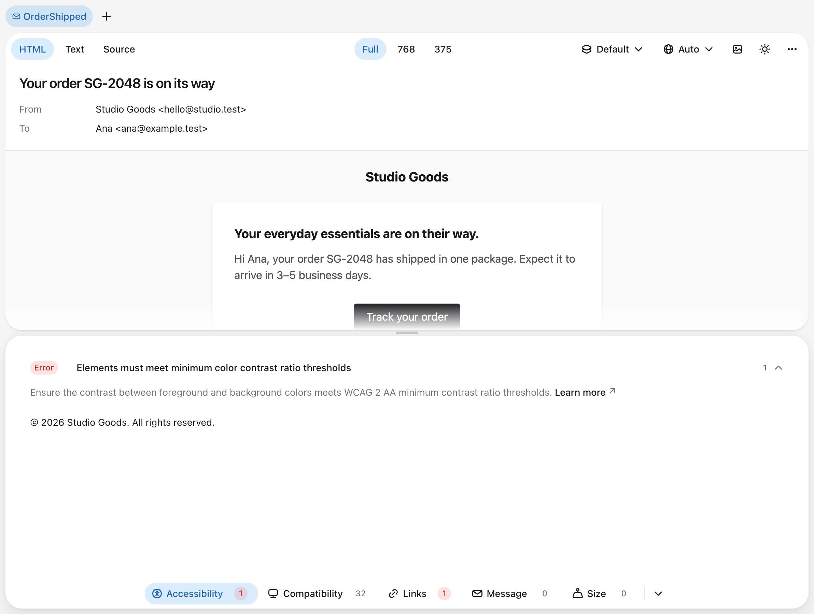
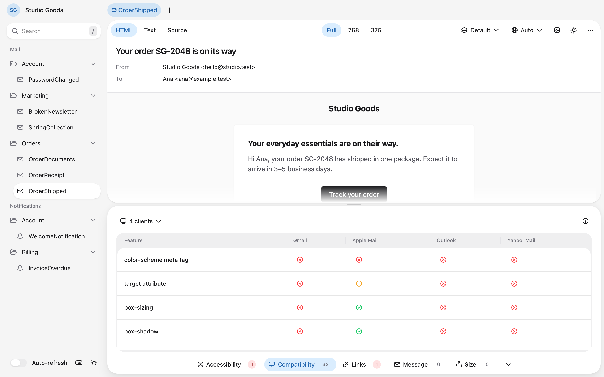
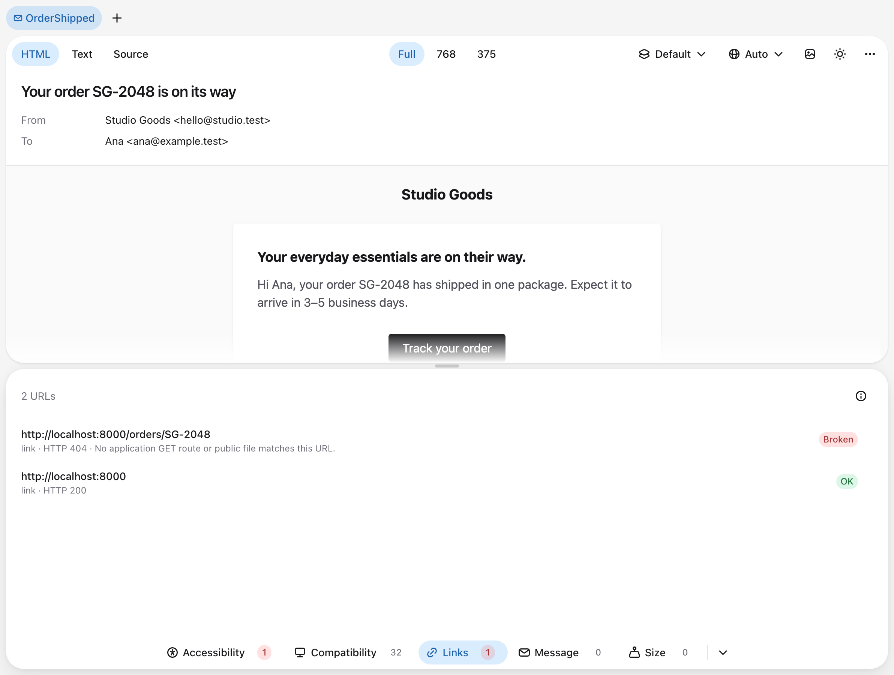
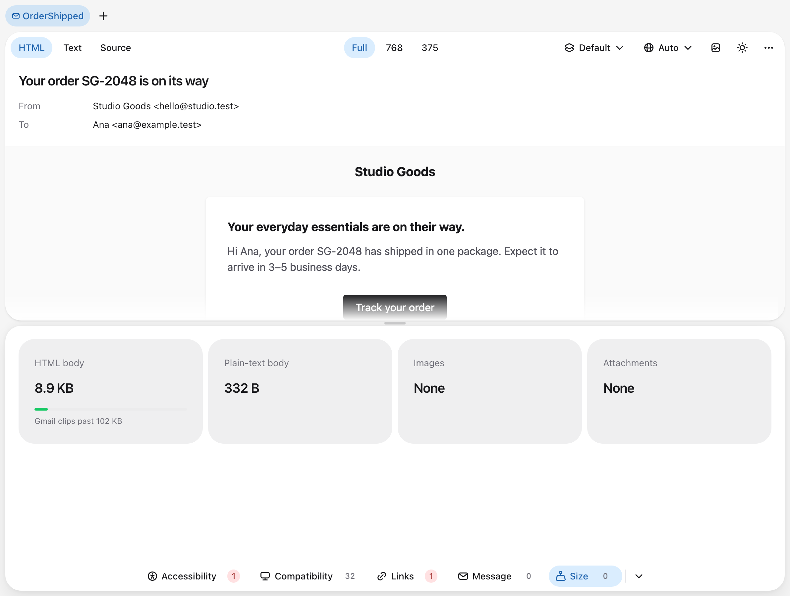

The preview checks each message when it renders. The bar under the email has a button for each check with the number of problems it found, in red when one of them is an error. A check that could not run shows Failed. Choose a check to open its results, and choose it again or press `C` to close them. Drag the edge between the email and the results to make them taller or shorter.

## Find a problem in the email

Accessibility and Message list each problem as a row with its severity and how many times it occurs. Errors come first, then warnings and info, each in the order the problems appear in the email. Open a row to read what the problem means and every place it occurs, such as an element of the email or a translation key. Select one of them, or a URL in Links, to find it in the email. Elements get an outline and text gets a highlight, in the subject as well as the body. Select it again to clear it.

## Accessibility

Accessibility runs [axe-core](https://github.com/dequelabs/axe-core) on the rendered HTML with the WCAG 2.2 AA and best-practice rules. It skips three rules written for web pages, which require a `main` landmark, all content inside landmarks, and a level-one heading. It covers contrast, alt text, link names, heading order, the document language, and the title, among others. Critical and serious problems are errors, moderate ones are warnings, and minor ones are info.

The check reads the email at a width of 600 pixels, in the color scheme the preview shows, so Dark mode gets its own contrast results. It runs in a hidden frame that executes none of the message's scripts and, like the preview, loads remote images only while they are not blocked.

## Compatibility

Compatibility lists the HTML and CSS features the message uses that one of the chosen mail clients does not fully support, the least supported first. The server reads the rendered HTML with [Can I email PHP](https://github.com/hosmelq/caniemail-php), so it covers Blade, Markdown, and the CSS Laravel inlines. The clients button above the table chooses the mail clients to check, Gmail, Apple Mail, Outlook, and Yahoo! Mail by default.

Select a feature to open its page on caniemail.com, or a status to see the platforms and notes behind it. No data means caniemail has not tested the feature in that client. The data ships with the package, works offline, and reflects the last version caniemail.com lists for each client.

## Links

Links lists every web URL of the message's links and images with its status: errors first, then warnings, then the rest, each in the order the URLs appear in the email. It checks them when the message renders and again when it changes, and Refresh checks them again.

| Status | Meaning | Severity |
| --- | --- | --- |
| Broken | The URL answers with an error, redirects to an address that is not a web URL, or no route or public file matches a link to the application. | Error |
| Unreachable | The host cannot be resolved or reached, TLS fails, the server does not answer within five seconds, or the URL redirects more than five times. | Error |
| Relative | A link or image URL that mail clients cannot resolve, such as `/orders/1`. | Error |
| Insecure | A link or image over plain `http://` that answers, on a host other than the preview's own or a loopback host such as `localhost`. | Warning |
| No destination | A link with an empty or `#` URL. | Warning |
| Redirected | The URL answers after one or more redirects. | Warning |
| OK | The URL answers. | None |

Links to the `APP_URL` host and to the host the preview is open on are matched against the application's GET routes and the files in `public` instead of being requested, so the check never opens your application's signed verification, password-reset, or unsubscribe links. A fallback route does not count as a match. A matching route does not guarantee that its middleware or controller will accept the link. Links on other hosts get a real `GET` request, including a mail service's tracking or unsubscribe links. [Security](../advanced-usage/security) lists what the check requests.

## Message

Message checks the translations and the plain-text body:

| Check | Severity |
| --- | --- |
| Translation keys missing from the rendered locale. | Warning |
| Placeholders a translation kept because no value was passed for them, such as `:name`. | Warning |
| HTML tags in the plain-text body. | Warning |
| A message without a plain-text body. | Info |

Selecting a key highlights the text the message shows for it, which is the fallback translation or the key itself, and selecting a placeholder highlights it in its sentence. A line with HTML tags opens the plain-text body with the line highlighted. A key the email shows only in an attribute, such as `alt` or `title`, is listed as Not shown as text and cannot be selected. [Locales and translations](../advanced-usage/locales-and-translations) explains which keys count as missing.

## Size

Size shows the weight of the HTML body, the plain-text body, the images, and the attachments. Gmail clips an HTML body over 102 KB, so the HTML body is measured against that limit. Embedded images count under Images at their own size, not under Attachments. Remote images count at the size their servers report, and an image whose server reports no size counts as unknown. A part with a problem shows its status:

| Status | Meaning | Severity |
| --- | --- | --- |
| Clipped by Gmail | HTML over 102 KB. | Error |
| Close to the limit | HTML from 90 KB. | Warning |
| Heavy | One or more images over 1 MB each, which slow the message down on mobile data. | Warning |

