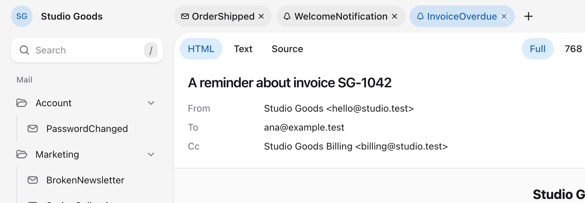
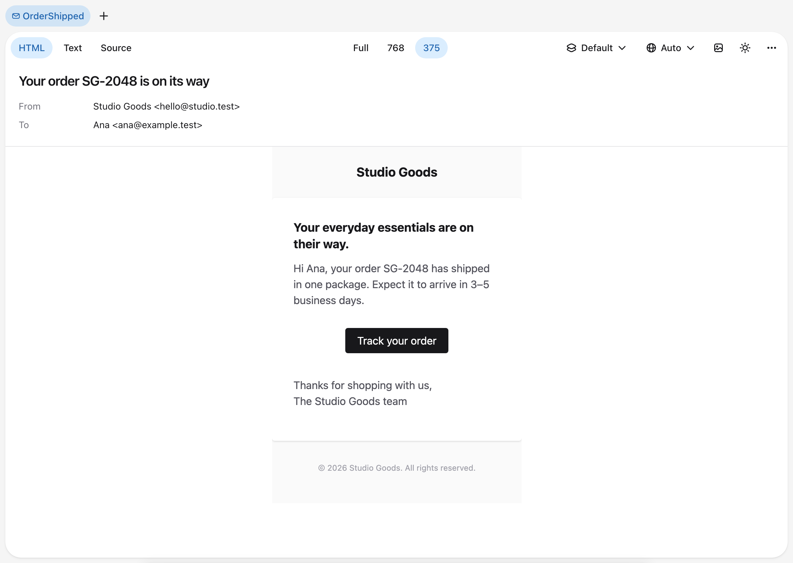
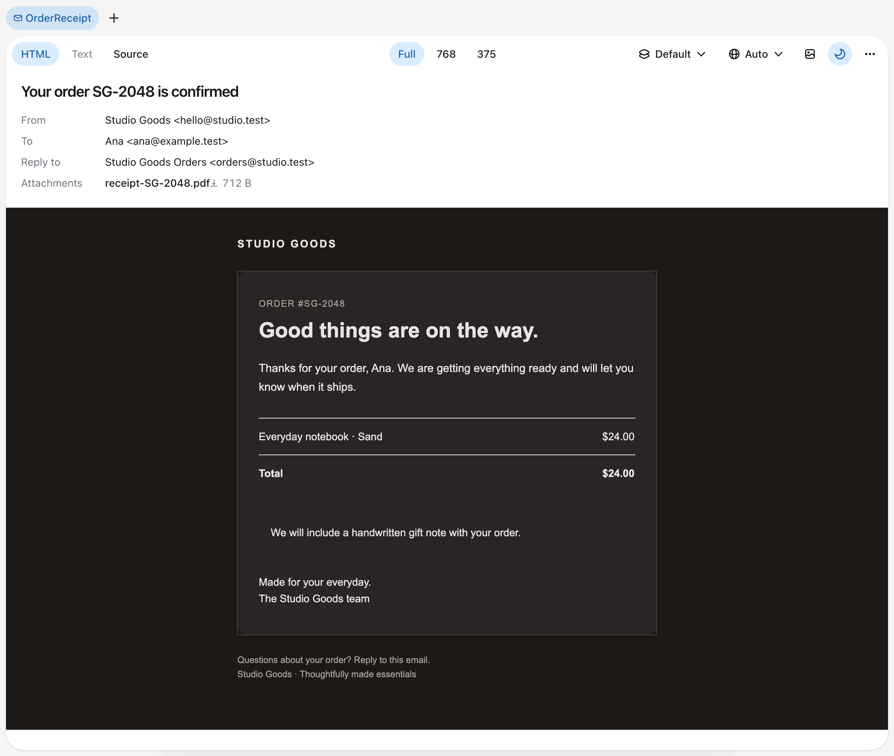
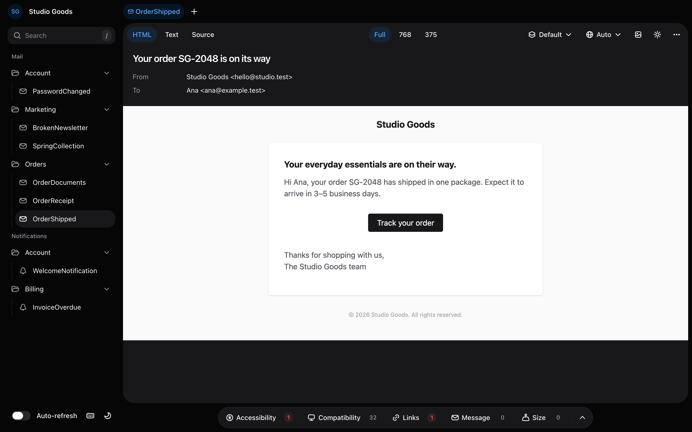

Select a message in the sidebar to render it. The preview remembers your settings in this browser, such as the width, Dark mode, Auto-refresh, and the closed folders. The message, variant, and locale are part of the page address, so the back button and bookmarks return to them. In a window narrower than 768 pixels, the sidebar opens as a drawer, and the tabs and the width switch are hidden.

## Move between messages

Open messages are tabs above the email. A click in the sidebar opens the message in the active tab. ⌘-click, Ctrl-click, or middle-click opens it in a new tab, and so does ⌘-Enter or Ctrl-Enter on a focused message. If the message is already open with the same variant and locale, its tab is selected instead. The plus button opens an empty tab. A tab's close button, or the Delete key on a focused tab, closes it, except the last one. Reloading the page keeps the tabs, and each browser tab has its own set.

`J` and `K` open the next and previous message in the tree, and `]` and `[` the next and previous variant. `R` refreshes and `L` turns Auto-refresh on or off. `T` switches between HTML and Text, `S` opens or closes Source, and `M` switches between the full and phone widths. `D` toggles Dark mode, `I` blocks or loads remote images, and `/` focuses the search field. Press `?`, or the keyboard button at the bottom of the sidebar, for every shortcut.

## Read the envelope

The subject, sender, recipients, reply-to address, and attachments appear above the email. Select an attachment to download it.

The preview builds the message with Laravel's mail pipeline and a mailer that keeps the message instead of sending it, so no mail or notification events are dispatched. A message that sets no sender gets the `from` address configured for its mailer in `config/mail.php`, or else `mail.from`. The `reply_to` address configured for the mailer, or else `mail.reply_to`, is added to every message, as Laravel does when it sends. A global `mail.to` address is not applied.

## Switch the body

HTML, Text, and Source at the start of the toolbar switch the view. Markdown mail always has a plain-text body; other mailables have one when they set a `text` view. The button for a body the message does not have is disabled.

Source shows the headers set on the message, such as `List-Unsubscribe`, tags, and metadata, followed by the HTML with its syntax highlighted, or the plain text when the message has no HTML. Markdown mail's CSS is already inlined, and embedded images show only their `data:` prefix.

## Set the width

The width switch in the toolbar sets the HTML body to the full width, a tablet width of 768 pixels, or a phone width of 375. The body keeps that exact width, so media queries such as `max-width: 600px` apply as they would on a screen that wide.

## Choose a variant or locale

When a message has [variants](sample-data), the variant menu in the toolbar renders another one. Selecting the message in the sidebar opens its default variant.

When the application has more than one locale, the locale menu renders the message in another one. Auto keeps the message's own locale. Any other choice overrides it and stays selected while you move between messages. [Locales and translations](../advanced-usage/locales-and-translations) explains which locale Auto picks.

## Dark mode and remote images

The Dark mode button renders the HTML body with the message's own `prefers-color-scheme: dark` styles. It does not imitate clients that invert colors on their own. With it off, the body uses its light styles, whatever your operating system's setting.

The Block remote images button hides remote images, as many clients do until the reader allows them. Embedded images still load, and blocked images show their `alt` text.

The theme menu at the bottom of the sidebar switches the preview itself between Light, Dark, and System. It does not change the email.

## Refresh and auto-refresh

Refresh, at the end of the Actions menu, renders the message again, checks its links again, and reloads the message list.

Turn on the Auto-refresh switch at the bottom of the sidebar to do the same whenever a file changes. While it is on and the browser tab is visible, the preview looks for changes every `auto_refresh.interval` seconds, 5 by default, in the directories of `discovery.paths`, the view paths, the `lang` directory, and `database/factories`.

Tools that record every request, such as Telescope, list each of these polls. Add the preview's path, `message-preview*` by default, to their ignored paths, such as `ignore_paths` in `config/telescope.php`.
