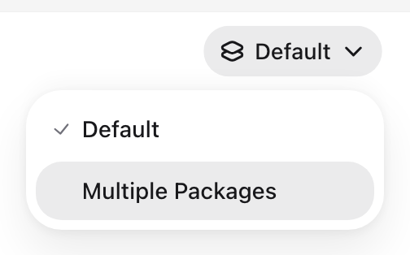

A mailable whose constructor needs no arguments renders as it is. Every other mailable, and every notification, needs a public static `previewConfig()` method that returns a `PreviewConfig`. The preview finds the method by its name, so the class needs no interface or trait.

## Build the message

Pass a closure that returns the message to `withMessage()`:

```php
use App\Models\Order;
use HosmelQ\MessagePreview\Support\PreviewConfig;
use Illuminate\Mail\Mailable;

final class OrderShipped extends Mailable
{
    public function __construct(public Order $order) {}

    public static function previewConfig(): PreviewConfig
    {
        return PreviewConfig::configure()
            ->withMessage(fn (): self => new self(Order::factory()->make()));
    }
}
```

The closure runs each time the preview renders the message. Without `withMessage()`, the preview creates the class with no arguments.

## Set the notifiable

A notification renders for the notifiable that would receive it, so its configuration needs `withNotifiable()`, even when the constructor takes no arguments:

```php
use App\Models\Invoice;
use App\Models\User;
use HosmelQ\MessagePreview\Support\PreviewConfig;
use Illuminate\Notifications\Notification;

final class InvoicePaid extends Notification
{
    public function __construct(public Invoice $invoice) {}

    public static function previewConfig(): PreviewConfig
    {
        return PreviewConfig::configure()
            ->withMessage(fn (): self => new self(Invoice::factory()->make()))
            ->withNotifiable(fn (): User => User::factory()->make());
    }
}
```

The notifiable needs a mail address. A model with the `Notifiable` trait uses its `email` attribute. For an address without a model, return an `AnonymousNotifiable`:

```php
use Illuminate\Notifications\AnonymousNotifiable;

->withNotifiable(fn (): AnonymousNotifiable => new AnonymousNotifiable()->route('mail', 'ana@example.com'))
```

The closure receives the notification, so the notifiable can come from its data:

```php
->withNotifiable(fn (self $notification): User => $notification->invoice->customer)
```

The preview calls `toMail()` and never `via()`, so it shows the mail message even when `via()` would send the notification on other channels only. Mailables ignore `withNotifiable()` and send to the recipients they set themselves.

## Add variants

A variant renders the same message with other data. Pass a name and a closure to `withVariant()`:

```php
return PreviewConfig::configure()
    ->withMessage(fn (): self => new self(Order::factory()->make()))
    ->withVariant('multiple-packages', fn (): self => new self(
        Order::factory()->hasPackages(3)->create(),
    ));
```

The variant menu in the toolbar labels `multiple-packages` as Multiple Packages. The message from `withMessage()` is the variant named `default`, and `withVariant()` with a name already in use, `default` included, replaces that variant. A variant's closure runs whenever the preview renders that variant, including ahead of time for the variants next to the open one.



A notification variant uses the closure from `withNotifiable()` unless you pass its own as the third argument:

```php
->withVariant(
    'team-invoice',
    fn (): self => new self(Invoice::factory()->forTeam()->make()),
    fn (self $notification): User => $notification->invoice->team->owner,
)
```

## Use saved models

The preview runs the message and notifiable closures and the mail pipeline inside a transaction on the default database connection, then rolls it back, even when rendering fails. Factories can use `create()` when a message needs real IDs or relations, and no rows are left behind.

Changes that do not go through that connection stay: files written, HTTP requests sent, and jobs or cache entries stored elsewhere. The preview renders a message whenever it needs it, including when you point at it in the sidebar, so keep those side effects out of sample data. If a transaction cannot start, for example because no database is configured, the message renders without one. Set `database.rollback` to `false` in the [configuration](../configuration) to keep database changes.

Each time the preview lists messages or renders, checks, sends, or downloads any of them, it calls the `previewConfig()` of every message, outside the transaction. Create data inside the closures, not in the method body.

## Repeatable data

The preview seeds PHP's random number generator from the message and variant before each render, so Faker returns the same values every time and a reload shows only what changed in the template. Values from `Str::random()`, UUIDs, and the current time still change. So do the IDs of models saved with `create()`, except on SQLite, because a rollback does not reset auto-increment counters.
