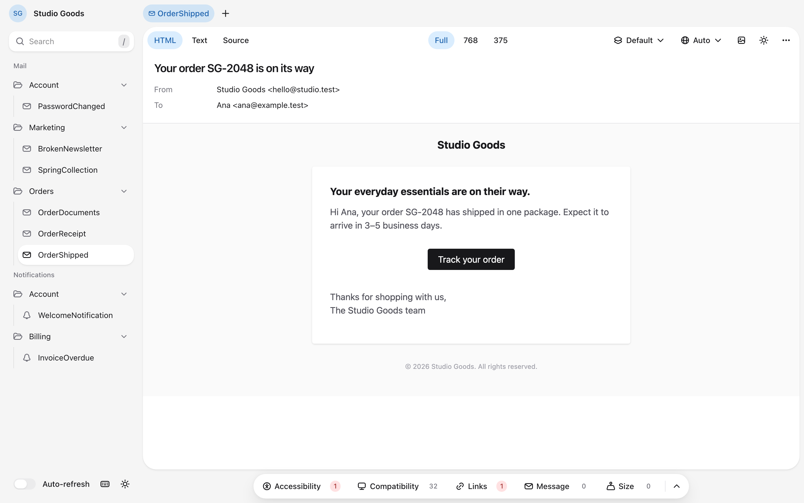

Laravel Message Preview finds the mailables and mail notifications in your application and renders them in the browser. Each preview shows the message Laravel would send: its subject, addresses, attachments, and HTML and plain-text bodies. Checks under the email report what would go wrong in an inbox: accessibility problems, features mail clients do not support, broken links, missing translations, and HTML large enough for Gmail to clip. You can also send the message to a real inbox.



## Quick start

After [installing the package](installation), open `/message-preview` in the browser. Mailables whose constructor needs no arguments are ready to preview. For the others, return sample data from a static `previewConfig()` method:

```php
use App\Models\Order;
use HosmelQ\MessagePreview\Support\PreviewConfig;
use Illuminate\Mail\Mailable;

final class OrderShipped extends Mailable
{
    public function __construct(public Order $order) {}

    public static function previewConfig(): PreviewConfig
    {
        return PreviewConfig::configure()
            ->withMessage(fn (): self => new self(Order::factory()->make()));
    }
}
```

Notifications also need the notifiable that receives them:

```php
return PreviewConfig::configure()
    ->withMessage(fn (): self => new self(Invoice::factory()->make()))
    ->withNotifiable(fn (): User => User::factory()->make());
```

## Next steps

- [Discovering messages](basic-usage/discovering-messages) explains which classes the preview lists and how to fix the ones that fail.
- [Sample data](basic-usage/sample-data) builds messages and notifiables, and adds variants.
- [Previewing messages](basic-usage/previewing-messages) covers tabs, widths, variants, locales, and keyboard shortcuts.
- [Checks](basic-usage/checks) explains what each check reports.
